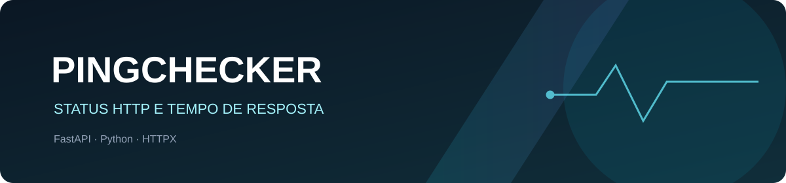

<p align="center">
  
</p>

<p align="center">
  
</p>

<p align="center">
  
  
  
  
</p>

O **PingChecker** é uma API REST desenvolvida com Python, FastAPI e HTTPX para consultar a disponibilidade de um endereço web, identificar o código de status HTTP e medir o tempo de resposta.

## Funcionalidades

- Verifica um endereço informado por URL.
- Retorna o código de status HTTP.
- Mede o tempo de resposta em milissegundos.
- Trata falhas de conexão e timeout.
- Retorna resultados em JSON.
- Disponibiliza documentação interativa pelo Swagger UI.

## Tecnologias

- Python
- FastAPI
- HTTPX
- Uvicorn
- pytest

## Como executar localmente

```bash
git clone https://github.com/nunogues/apicheck.git
cd apicheck
python -m venv .venv
```

Ative o ambiente virtual:

```bash
# Windows
.venv\Scripts\activate

# Linux / macOS
source .venv/bin/activate
```

Instale as dependências e inicie o servidor:

```bash
pip install -r requirements.txt
uvicorn main:app --reload
```

A API ficará disponível em `http://127.0.0.1:8000`. A documentação interativa fica em `http://127.0.0.1:8000/docs`.

## Endpoint

### GET /check

Consulta um endereço web.

| Parâmetro | Tipo | Descrição |
|---|---|---|
| `url` | string | Endereço completo, incluindo `https://` |

Exemplo:

```http
GET /check?url=https://example.com
```

Resposta ilustrativa:

```json
{
  "success": true,
  "data": {
    "url": "https://example.com",
    "status": "online",
    "code_status": 200,
    "response_time_ms": 135.42
  }
}
```

Os valores variam conforme o destino e a conexão.

## Testes

Instale as dependências de desenvolvimento e execute:

```bash
pip install -r requirements-dev.txt
pytest -q
```

O repositório também executa os testes automaticamente pelo GitHub Actions em novos pushes e pull requests.

## Estrutura

```text
apicheck/
├── assets/
│   └── banner.svg
├── routes/
│   ├── __init__.py
│   ├── check.py
│   └── health.py
├── tests/
│   └── test_check.py
├── main.py
├── requirements.txt
└── requirements-dev.txt
```

## Observação de segurança

O endpoint recebe uma URL e faz uma requisição a ela. Antes de disponibilizar esta API publicamente, implemente validação rigorosa de URLs e controles contra acesso a endereços internos ou privados (SSRF), além de limites de uso. A versão atual é um projeto de aprendizagem e não deve ser tratada como um serviço público endurecido para produção.

## Objetivo

Projeto de aprendizagem sobre desenvolvimento de APIs REST, requisições HTTP, tratamento de erros e organização de aplicações com FastAPI.
